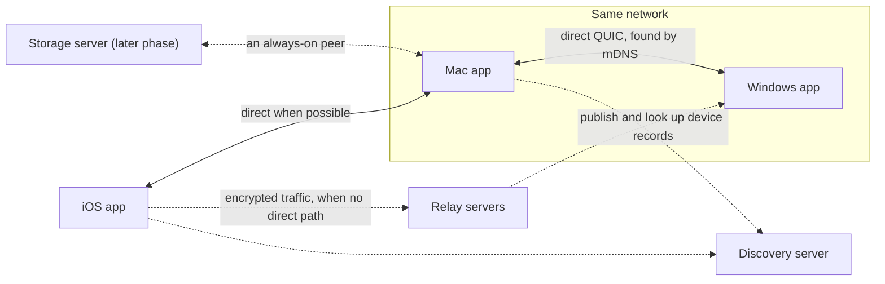

# Osaurus Sync

Local-first, end-to-end encrypted sync of Osaurus conversations across a user's devices. One Rust
core runs inside the Mac, iOS and Windows apps, through generated Swift and C# bindings.

- **Peer to peer.** Devices sync directly over QUIC ([Iroh](https://iroh.computer)), finding each
  other on the LAN with mDNS or anywhere through DNS discovery. Relays only forward encrypted
  traffic when there's no direct path. The app chooses the relay and discovery servers, and
  they store nothing.
- **Local first.** Reads and writes hit local SQLite and return in well under a millisecond. The
  app works the same offline, and changes sync when devices reconnect.
- **Encrypted and signed.** Every change is a signed event. Content is encrypted with per-scope
  keys that only member devices hold.
- **Convergent.** Any devices with the same events show the same conversations, whatever order
  the events arrived in. Edits, deletions, reactions and metadata all merge without conflicts.
- **Built for real use.** Recent conversations sync first, older history backfills in the
  background (and pauses on battery or cellular), and agent responses stream live to other
  devices.

## How it works



- **Events.** Every change (a message, an edit, a reaction, a rename, a membership change) is
  an event signed by the device that made it. Devices exchange the events the other side is
  missing, and each device builds its own views (the conversation list, message pages, search)
  from the events it holds. The merge rules make every device arrive at the same views.
- **Scopes and keys.** Each conversation (or workspace) is a scope with its own members and
  encryption key. Content is encrypted to that key, and the key is sealed to each member device.
  A user's devices share one user identity, set up by pairing, and the 24-word recovery phrase
  can restore it on a device with no other device to pair with.
- **What servers see.** Relays and the discovery server never see content, titles, attachments
  or keys. They see device ids, IP addresses and traffic timing. The
  [client guide](docs/client-guide.md#what-each-setting-discloses) lists what each one learns.

The [architecture](docs/architecture.md) doc describes the data model, the sync protocol and the
merge rules in detail.

## Status

The current release is **`v0.1.0-beta.1`**, an internal prerelease for building the client
apps. "Beta" here means:

- The API and the wire protocol are versioned from this release on. Beta builds on different
  devices must keep syncing with each other, so incompatible changes bump the versions (see
  [Compatibility and versioning](#compatibility-and-versioning)).
- The Windows DLLs are not code-signed yet, and the packages are only attached to the GitHub
  release, not published to NuGet or a Swift package repository.
- It isn't ready to ship to users. The [gates before general availability](#before-general-availability)
  are listed below.

What's in it:

| Area | State |
| --- | --- |
| Own-device sync: pairing, recovery phrase, revocation, identity rotation | Ready |
| Messages, attachments, edits, deletions, reactions, conversation metadata | Ready |
| Streaming agent responses, gradual sync and backfill, point-in-time views | Ready |
| Data management: export, storage usage, leave, reset; logging and support bundles | Ready |
| Sharing: roles, invites, removals, agents | In the core and the API; not yet product-tested |
| Compaction | In the core; only runs once a storage server exists |
| MLS group keys, the Osaurus storage server | Later phases |

### Before general availability

- An external cryptography review against a frozen protocol (see the
  [threat model](docs/threat-model.md#external-review)).
- Osaurus-run relay and discovery servers in place of the public development ones (see
  [Deployment](docs/deployment.md)).
- Code-signed Windows libraries, and packages published to NuGet and the Swift distribution
  repository.
- The [device validation](docs/development.md#device-validation) checklists, run on the
  release-candidate build.

## Known limitations

- **Devices only sync while another device that has the changes is online.** There's no
  always-on peer yet, so with two devices, both have to be online at the same time. A storage
  server would remove this limit.
- **History only grows.** Compaction waits for a storing peer to hold the history, so nothing is
  compacted until a storage server exists.
- **Some extra traffic.** A device pulling from several peers at once can fetch some events more
  than once. The duplicates are discarded; only bandwidth is wasted.
- **Views are stored in plaintext.** Events are encrypted, but the local views (titles, message
  text, the search index) aren't. Rely on OS disk encryption: FileVault, iOS data protection,
  BitLocker.
- **iOS keeps recent history by default.** The last 90 days sync, and older messages are
  fetched when the user scrolls back.

The [client guide](docs/client-guide.md#known-limitations) explains how to design around each of
these.

## Platforms

| Platform | Package | Key storage |
| --- | --- | --- |
| macOS 14+ (Apple silicon) | Swift package, [`bindings/swift`](bindings/swift) | Keychain |
| iOS 17+ (device and simulator) | Swift package, [`bindings/swift`](bindings/swift) | Keychain (this device only) |
| Windows x64 and arm64 | NuGet `Osaurus.Sync`, [`bindings/csharp`](bindings/csharp) | DPAPI |

The NuGet package also contains an `osx-arm64` library, so C# code can be developed and tested on
a Mac. There is no Intel Mac build.

## Getting started

### Installing a release

Each release on GitHub has:

| Asset | Use |
| --- | --- |
| `OsaurusSync-swift-local-<version>.zip` | The Swift package with the XCFramework inside. Add it as a local package |
| `OsaurusSync-swift-<version>.zip` | The Swift package that downloads the XCFramework by URL; for the distribution repository |
| `OsaurusSyncFFI.xcframework.zip` and `.checksum` | The XCFramework alone, and its SwiftPM checksum |
| `Osaurus.Sync.<version>.nupkg` | The NuGet package with all native libraries |
| `THIRD_PARTY_NOTICES.md`, `*.cdx.json` | Open source notices and an SBOM per target |

The repository is private, so download the assets with the GitHub CLI:

```sh
gh release download v0.1.0-beta.1 -R osaurus-ai/osaurus-sync \
  -p 'OsaurusSync-swift-local-*.zip' -p '*.nupkg'
```

- **Swift:** unzip the local package into the app's repository (for example
  `Vendor/OsaurusSync`), then add it in Xcode with **File > Add Package Dependencies > Add
  Local**, or as `.package(path: "Vendor/OsaurusSync")`, and link the `OsaurusSync` library.
  See [Adding the package](bindings/swift/README.md#adding-the-package).
- **C#:** put the `.nupkg` in a folder, add the folder as a NuGet source, and reference
  `Osaurus.Sync`. See [Installing](bindings/csharp/README.md#installing).

To build from source instead, see [Building](#building).

### A first integration

Open one core per data directory at startup. For development and beta builds, use the public
development servers so devices can sync over the internet; ship your own servers through remote
configuration later (see [Deployment](docs/deployment.md)).

```swift
import OsaurusSync

let core = try SyncCore.open(
    dataDirectory: appSupport.appendingPathComponent("Sync"),
    deviceName: UIDevice.current.name,                   // Host.current().localizedName on macOS
    network: n0PublicNetworkConfig()                     // development and beta only
)
let lifecycle = SyncLifecycle(core: core)                // iOS only: suspend and resume with the app
lifecycle.start()

// The conversation list, and one conversation.
let listSub = core.subscribeConversations { changes in /* update the list */ }
let scope = try core.createConversation(title: "Trip plans")
let sub = try core.subscribe(scope: scope) { changes in /* update the messages */ }
_ = try core.sendMessage(scope: scope, message: .text("Book the flights"))

// Pairing. On the device that's already set up, show the payload as a QR code:
let offer = try core.pairingOffer(ttlMs: 300_000)
// On the new device, scan it:
try await core.pairWithOffer(payload: scanned)          // result: CoreEvent .paired or .pairingFailed
```

```csharp
using Osaurus.Sync;

var dir = Path.Combine(Environment.GetFolderPath(Environment.SpecialFolder.LocalApplicationData), "Osaurus", "Sync");
using var core = OsaurusSync.Open(dir, Environment.MachineName,
    network: OsaurusSyncFfiMethods.N0PublicNetworkConfig());      // development and beta only

using var listSub = core.SubscribeConversations(changes => { /* update the list */ });
var scope = core.CreateConversation("Trip plans");
using var sub = core.Subscribe(scope, changes => { /* update the messages */ });
core.SendMessage(scope, OsaurusSync.Text("Book the flights"));

var offer = core.PairingOffer(300_000);                 // existing device: show offer.Payload
await core.PairWithOffer(scanned);                      // new device

await core.Suspend();                                   // on sleep
await core.Resume();                                    // on wake
await core.Close();                                     // on exit
```

Callbacks run on the core's callback thread, so hop to the UI thread before touching UI. Next,
read the [client guide](docs/client-guide.md): it covers every call, and ends with an
[integration checklist](docs/client-guide.md#integration-checklist).

## Deployment

There is no central data server. Conversations live on the user's devices, and devices sync with
each other directly.

- **On one network,** devices find each other with mDNS and need no servers at all.
- **Over the internet,** devices need relay servers (`iroh-relay`) to reach each other through
  NATs, and a discovery server (pkarr) to look each other up by device id. Neither stores
  conversation data, and both see only encrypted traffic.
- **The app chooses the servers** in `NetworkConfig`. The core doesn't default to anyone's.
  Development builds can use `n0PublicNetworkConfig()`, number0's public servers; shipping
  builds should use Osaurus servers, configured through remote configuration.
- **A storage server** is a later phase: an always-on peer that would deliver changes while the
  user's other devices are offline, and allow compaction. The core already supports its role.

[docs/deployment.md](docs/deployment.md) covers running the servers, configuring the clients and
the rollout order.

## Compatibility and versioning

| Version | Checked | When it changes |
| --- | --- | --- |
| `API_VERSION` | At `open`, between the bindings and the native library | An incompatible change to the exported API. A mismatch fails with `incompatibleVersion` |
| `PROTOCOL_VERSION` | In the sync handshake, between devices | A wire change older devices can't handle. Peers on different versions don't sync, and the app gets an `incompatiblePeer` event to suggest updating |
| Database migrations | At `open` | Numbered and applied on upgrade. A database from a newer release fails with `newerDatabase` instead of being downgraded |

Both versions are 1. Compatible changes, such as new event kinds or new API calls, don't bump
them: older devices store and forward event kinds they don't understand. Error codes and
rejection codes are stable and only appended. The [architecture](docs/architecture.md#compatibility-and-versioning)
and [development](docs/development.md#changing-the-wire-format) docs have the full rules.

## Getting help

For a bug report, attach `supportBundle()`. It's a redacted JSON report with the versions,
connection state per peer and scope, counters and the last 500 log records, with no content,
names or addresses. For connection problems, check `diagnostics()` first: whether the relays
are connected (`homeRelays`), and whether each peer is connected, relayed and syncing. The
client guide has a [troubleshooting](docs/client-guide.md#troubleshooting) section.

## Documentation

- **[Client guide](docs/client-guide.md):** integrating the library into an app. Covers opening
  the core, reading and writing, subscriptions, streaming, pairing, history, errors, known
  limitations, an integration checklist, troubleshooting and testing.
- **[Swift package](bindings/swift/README.md):** setup for macOS and iOS, Keychain, the app
  lifecycle, backfill policy and the Info.plist keys for local network discovery.
- **[C# package](bindings/csharp/README.md):** setup for Windows, the generated API's naming,
  threading, DPAPI and the firewall prompt.
- **[Deployment](docs/deployment.md):** the relay and discovery servers, client network
  configuration, the future storage server and the rollout order.
- **[Architecture](docs/architecture.md):** the data model, envelope format, keys, membership
  rules, storage, merge rules, the sync protocol, networking, compaction and testing.
- **[Threat model](docs/threat-model.md):** what is protected against whom, trust boundaries,
  known limits and the scope of the external review.
- **[Development](docs/development.md):** building, testing, the simulation harness,
  benchmarks, fuzzing, device validation, dependencies, CI and releasing.
- **[Changelog](CHANGELOG.md):** what changed in each release.

## Repository layout

| Path | Contents |
| --- | --- |
| [`crates/osaurus-sync-core`](crates/osaurus-sync-core) | Events, crypto, validation, storage, Loro, views and the sync engine. No I/O |
| [`crates/osaurus-sync-net`](crates/osaurus-sync-net) | Iroh networking: discovery, relays, streams, blobs, pairing |
| [`crates/osaurus-sync-ffi`](crates/osaurus-sync-ffi) | The UniFFI surface the bindings are generated from |
| [`crates/osaurus-sync-sim`](crates/osaurus-sync-sim) | Deterministic simulation harness (tests only) |
| [`bindings/swift`](bindings/swift) | Swift package for macOS and iOS |
| [`bindings/csharp`](bindings/csharp) | .NET 8 package and tests |
| [`scripts`](scripts) | Building the XCFramework, generating bindings, packing NuGet and the release Swift packages |
| [`tests/fixtures`](tests/fixtures) | Signed events from earlier builds, for compatibility tests |
| [`fuzz`](fuzz) | cargo-fuzz targets for the decoders and reconciliation |

## Building

```sh
cargo test --workspace                            # core, networking, FFI and simulation tests
scripts/build-xcframework.sh                      # Swift: build the XCFramework and bindings
(cd bindings/swift && swift test)
scripts/gen-csharp.sh                             # C#: build the native library and bindings
dotnet test bindings/csharp/OsaurusSync.Tests
```

The Rust toolchain is pinned in `rust-toolchain.toml`. The Swift package needs Xcode 16 or
later, and the C# package the .NET 8 SDK and
[uniffi-bindgen-cs](https://github.com/NordSecurity/uniffi-bindgen-cs). See
[Development](docs/development.md) for the requirements and the full workflow, including
[releasing](docs/development.md#releasing).

## License

Proprietary; see [`LICENSE`](LICENSE). Releases include `THIRD_PARTY_NOTICES.md` for the open
source components in the native library, and a CycloneDX SBOM per target.
