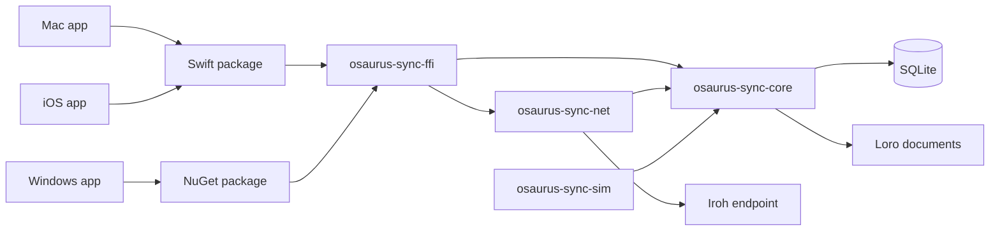
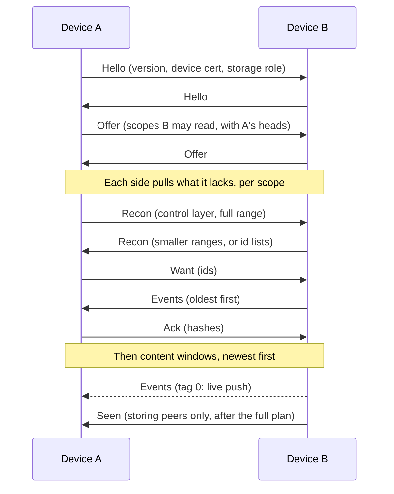

# Architecture

This document describes how Osaurus Sync is built: the data model, how events are validated and
merged, how peers sync, and how the pieces fit together. For the app-facing API, see the
[client guide](client-guide.md).

## Goals and constraints

- **Peer to peer, no Osaurus-hosted storage.** A user's devices sync directly with each other.
  Relays only forward encrypted QUIC traffic when a direct path isn't available.
- **Local first.** Every read and write hits local SQLite. The network only moves events between
  replicas, so the app works the same offline.
- **Convergence without a coordinator.** Any two devices that hold the same events show the same
  conversations, in any delivery order, with no central authority deciding who may do what.
- **One core, many apps.** The Mac, iOS and Windows apps share one Rust core through generated
  Swift and C# bindings.

Phase 1 covers sync across one user's own devices. The membership and permission engine is built
in full already, because it's pure library logic and later phases (sharing, teams, Osaurus Server)
depend on it.

## Components



| Crate | Role |
| --- | --- |
| `osaurus-sync-core` | Events, crypto, identity, validation, storage, Loro, views and the sync engine. It does no I/O of its own. |
| `osaurus-sync-net` | The Iroh endpoint, discovery, relays, dialing, ephemeral streams, blob transfer and pairing transport. |
| `osaurus-sync-ffi` | The UniFFI surface. The only crate that knows about bindings. Builds as `cdylib`, `staticlib` and `lib`. |
| `osaurus-sync-sim` | Test-only. Runs many core engines on a seeded virtual network. |

The most important design decision is that **the sync engine is sans-I/O**. The engine takes in
peer messages and timer ticks and returns outputs: messages to send, connections to close, and
notices for the app. `osaurus-sync-net` carries those outputs over QUIC, and `osaurus-sync-sim`
carries them over an in-memory network driven by a seeded RNG. Every protocol decision is
therefore exercised by deterministic tests, and a failing seed replays exactly.

## Data model

### Scopes

A **scope** is the unit of sync and of access control. Each conversation and each workspace is
one scope. A scope has its own event DAG, its own members and its own encryption keys. Scope ids
are UUIDv7, so they sort by creation time.

### Events

Everything that happens in a scope is an append-only, signed **event**. Events are never edited
in place. An edit, a deletion or a rename is a new event that refers to an older one.

Event kinds are split into two layers:

| Layer | Kinds | Payload |
| --- | --- | --- |
| Content | `message` (1), `message_edit` (2), `tombstone` (3), `reaction` (4) | Encrypted with the scope's epoch key |
| Control | `genesis` (16), `member_add` (17), `member_remove` (18), `role_change` (19), `device_cert` (20), `device_revoke` (21), `agent_assign` (22), `key_update` (23), `invite` (24) | Plaintext: public keys, roles, sealed keys |
| Control (encrypted) | `loro_update` (5) | Encrypted; synced with the control layer |

Kinds 16 to 63 are reserved for control events. A peer that receives an unknown kind still stores
and forwards it, and syncs it in the right layer, but doesn't apply it. This keeps older builds
from breaking the DAG for newer ones.

Control payloads are plaintext so that a peer can validate membership without being able to read
the conversation. `loro_update` is the exception: it holds conversation metadata, so it's
encrypted, but it syncs with the control layer because views need it early.

### The envelope

Each event is wrapped in a canonical, hand-encoded envelope (`envelope.rs`). The encoding is
fixed-order and little-endian, so the signed bytes and the hash are identical on every platform
and stay stable across releases.

```text
wire:   signed_len u32 | signed bytes | has_payload u8 | [payload bytes] | sig 64

signed: version u16 | id 16 | scope 16 | author 32 | hlc u64 |
        n_control u16 | control_parents 32*n | n_parents u16 | parents 32*n |
        kind u16 | epoch u64 | payload_len u32 | payload_hash 32
```

Some properties follow directly from this layout:

- **`version`, `id` and `scope` lead every version**, so a peer can route and store an event
  from a newer envelope version without understanding the rest.
- **The signature covers the payload's BLAKE3 hash, not the payload.** A peer can drop a payload
  (after a deletion, or during compaction) and still prove the event is authentic and serve it as
  a parent.
- **Parents are split.** `control_parents` are the author's heads of the scope's control
  sub-DAG; `parents` are the other heads. Permission checks only need the control sub-DAG, which
  syncs first, so a message can be validated while older messages are still backfilling.
- The event **hash** is the BLAKE3 hash of the signed bytes, and is how the DAG refers to events.
- The **author** is the device's Ed25519 public key. The envelope says which device wrote an
  event; the device certificate says which user that device belongs to.

Payloads are encoded with `postcard` and encrypted with XChaCha20-Poly1305, using the event id as
associated data, so a ciphertext can't be moved to another event.

### Clocks and ordering

Each event carries a **hybrid logical clock** (HLC): physical milliseconds in the high 48 bits
and a logical counter in the low 16. Each device's HLC strictly increases, and it advances past
any HLC it receives. Message order in a conversation is `(hlc, author, id)`.

Wall clocks never decide validity. They only order messages for display and pick the newest edit.

## Identity and keys

| Secret | What it is | Where it lives |
| --- | --- | --- |
| Device key | Ed25519, generated per install. Signs every event, and is the Iroh endpoint id. | The OS key store (`device-key`) |
| User secret | 32 bytes of entropy, shown as a 24-word BIP39 phrase. HKDF derives the user's Ed25519 key from it. | The OS key store (`user-secret`) |
| Scope keys | One symmetric key per scope epoch | Never stored. Each device unseals them from `key_update` events |

- A **device certificate** is the user key's signature over a device key, its name and platform.
  It's how other devices learn that a device acts for a user.
- **Scope keys** are sealed to each member device's X25519 key (derived from its Ed25519 key)
  inside `key_update` events. Removing a member or revoking a device rotates to a new epoch, and
  the new key is sealed only to the remaining devices. Phase 1 uses this simple scheme; MLS is
  deferred.
- **Recovery grants.** Each user also has a recovery key, an Ed25519 key that HKDF derives from
  the user secret (`osaurus-sync/recovery-key/v1`). Scope keys are sealed to it exactly as to a
  device, as a `KeyGrant` addressed to the recovery public key, so the wire format is unchanged.
  New scopes and rotations include the creator's recovery key. Every device also repairs
  missing grants on its own: whenever it holds keys its user's recovery key lacks, it publishes
  a `key_update` adding them. That covers other members and scopes from before this scheme.
  `unseal_grants` tries the device key and then the recovery key.
- **Consequence for revocation.** A revoked device that still has the user secret can derive
  the recovery key, so it can read new epochs, and it can certify a fresh device key. A plain
  revoke is for lost or wiped devices; a stolen device needs
  [identity rotation](#identity-rotation), which replaces the user secret.
- **Device keys never leave the device.** The core never writes private keys to SQLite. On Apple
  platforms the Keychain items are `ThisDeviceOnly`, so a restored or migrated device gets a fresh
  device key.
- **Restored databases are kept.** A database whose stored device key differs from the key
  store's was restored or copied. Its events, blobs and views stay. The per-install state resets:
  the device certificate, Loro peer id, outbox, peer records and revoked flag. Conversation roles
  are recomputed (to none, since the new device isn't certified yet), and `RecoveryAvailable` is
  raised. Once the device holds that identity (from the phrase, or a synced keychain),
  `finish_recovery` presents its own certificate in each scope its user belongs to, drains
  `pending_decrypt` through the recovery grants, and repairs grants.
- **Agents** have their own secp256k1 identity. An agent binding, signed by the agent's key,
  names the device that hosts it and an expiry. `agent_assign` puts an agent in a scope; the
  latest causally valid assignment wins.

## Membership and validation

Each scope's control sub-DAG defines its members. Every peer runs the same deterministic
computation (`auth.rs`) over the same control events, so all members agree on the outcome.

**Validity is causal.** Whether an event is allowed is decided by the membership state of its
own causal ancestors, never by when it arrived or by anyone's wall clock.

**Roles:**

| Role | Can do |
| --- | --- |
| Viewer | Read |
| Member | Read; post messages, edits, reactions and Loro updates; assign agents |
| Admin | Member rights, plus add, remove and re-role Viewers and Members; create invites below Admin |
| Owner | Everything, including managing Admins and revoking any device |

Two more rules apply: anyone may remove themselves, and a user may revoke their own devices.
Edits are only accepted from the message's author. A deletion by the author or by an Admin
purges the message.

**Concurrent conflicts** resolve in this order:

1. **Removal wins** over any concurrent action by or about the removed member. A removal records,
   for each of the removed member's devices, the highest HLC the remover had seen from it.
   Events from those devices above that cutoff that aren't ancestors of the removal are
   rejected.
2. **The higher role wins.**
3. **The lower author key wins.**

If two removals would cut each other off, the earlier one in the deterministic topological order
(HLC, then hash) stands.

**Rejected events are kept.** An event that fails validation is stored with status `rejected`
and a stable reason code, so it isn't fetched again, and the app shows it as not delivered. An
event that arrives before its control parents waits in the `held` table until they do.
`held_needs` indexes each held event by the parents it lacks, so a stored event releases only
its own waiters. Held events are capped per scope and per sending peer (10,000 events or
64 MiB each, configurable), and are dropped after 7 days. An event dropped at the cap is fetched
again on a later sync.

## Storage

Each replica is one SQLite database in WAL mode, plus a blob directory, in the app's data
directory. A lock file makes sure only one process opens a data directory at a time.

- **`events` is the source of truth.** It stores every envelope, with its status (`valid`,
  `rejected`, `unsupported`) and whether its payload was purged (`deleted` or `compacted`).
- **Every other table is a cache** rebuilt from `events`. When the view schema version changes,
  the view tables are dropped and replayed. The views are `messages_view`, `messages_fts`,
  `edits`, `tombstones`, `reactions` and `conversations_view`.
- Supporting tables track DAG heads, held events, the outbox, peers, storage peers, known and
  revoked devices, retired users, blobs, Loro snapshots and read state.
- **Retention.** `Replica::maintain`, which the network node runs at start and then hourly, does
  the following:
  - expires held events;
  - prunes invites that are expired or used;
  - drops contact records for peers that are revoked or unseen for 90 days;
  - forgets other users' devices that are no longer certified in any scope;
  - purges tentatively joined scopes still unproven after a day;
  - takes over scopes that still list a retired user (see [Identity rotation](#identity-rotation));
  - seals keys to the user's recovery key where that grant is missing;
  - evicts decrypted attachments (`blobs/plain`) by least-recent use, above
    `plain_cache_bytes` (512 MiB by default). Opening an attachment also enforces this cap.
- **Session budgets.** Within each one-minute window, a session may receive 500k events or
  2 GiB in total, but only 20k events or 256 MiB of those as unsolicited pushes. It may also send
  1,000 invalid events per session. An untrusted session (one that is redeeming an invite) may
  send 16 messages. A peer that goes over any of these is sent `Bye` and disconnected.

**At rest**, event payloads are encrypted but the view tables hold plaintext so they can be
searched and read quickly. Phase 1 relies on full-disk encryption (FileVault, BitLocker, iOS data
protection) for the database.

### The write path

Local writes and received events go through the same `accept` function, so they're validated
and applied by exactly the same code. A local write runs in one SQLite transaction:

1. Build the payload, encrypt it, and sign the envelope.
2. Append it to `events` and update the heads.
3. Apply it to the views.
4. Add it to the outbox.
5. Commit, then notify subscribers.

Subscribers only hear about committed state, and a crash can't leave the views half-updated.

### Merge rules

Every rule is order independent, which is what makes invariant 4 hold (see
[Testing](#testing-and-verification)):

- **Messages** form a grow-only set.
- **Edits** are last-writer-wins by `(hlc, author)`, among the author's own edits.
- **Tombstones** win over the message and all its edits. A tombstone purges the payload; the
  envelope stays so the DAG remains intact. Purging can't be undone, so deletions are checked
  against their causal past only.
- **Reactions** are an observed-remove set. A remove names the adds its author had seen, so a
  concurrent add survives.
- **Conversation metadata** (title, pinned, archived, sort order) and agent state live in one
  Loro document per scope, which merges itself.

### Loro documents

Each scope has one `LoroDoc`. Each device install gets its own Loro peer id. A document loads
from its latest snapshot plus the `loro_update` events after it. Snapshots are written every 500
updates and on clean shutdown or suspend, and inactive documents are evicted from memory.

### Blobs

Attachments are encrypted with their own random key and stored on disk under the BLAKE3 hash of
the ciphertext. The key lives only inside the message's encrypted payload, so deleting the
message makes the blob unreadable even where its bytes remain. Peers only serve a blob to devices
that can read a scope referencing it, and downloads resume from the partial file.

## Sync protocol

Peers speak `osaurus/sync/1`: postcard-encoded, length-prefixed frames on one bidirectional QUIC
stream per connection.



1. **Hello.** Both sides send their protocol version, device certificate and whether they have
   the storage role. A peer with a different major version gets `IncompatiblePeer`.
   **Admission** follows. A peer is trusted if its certificate belongs to this user, or to a
   user who is a member of (or certified in) a scope held here, and its device isn't revoked.
   A certificate of a user this device has retired by rotation is never trusted, except from
   a device this user re-certified, which is owed the new identity. The inviter named in a
   queued invite is also trusted by the redeemer. An untrusted peer is sent `Bye` and reported
   as `PeerRejected`. The one exception: while this device has an unexpired, unused invite
   open, an untrusted session stays up so its peer can send `InviteRedeem`.
   Nothing else from an untrusted peer is processed: offers, reconciliation, pushes, acks and
   `Seen` are all dropped.
2. **Offer.** Each side lists the scopes it believes the other may read, with its heads for each
   layer. A side refuses a scope with `Denied` if the other isn't a member. A scope that is
   offered but not held here is joined *tentatively*. Once its control layer has synced, the
   scope is kept only if it lists this user (or this device). Otherwise it is purged, along with
   everything stored for it. Events for a scope this device never joined are refused.
   `conversations()` lists only scopes where this user has a role. A peer that could read only
   a scope's control layer when it was offered (a removed member, say) is offered the scope
   again once it's admitted, so it fetches the content in the same session.
3. **Reconcile.** Each side acts as initiator for its own pulls. Reconciliation is range-based
   over `(hlc, id)` keys (`recon.rs`). A range carries a fingerprint, the full id list, or
   nothing if it's already in sync. The responder answers with smaller ranges until every range
   matches. It keeps no state, because each side learns what it lacks from the id lists.
4. **Fetch.** `Want` asks for missing events. `Events` returns them oldest first, in chunks of
   up to 1 MiB, with at most 8 requests in flight. Received events are applied in causal order.
5. **Acknowledge.** `Ack` lets the sender clear those events from its outbox. Outbox events are
   retried on every connection until acknowledged, which is how writes made offline or while
   suspended get delivered.
6. **Live push and gossip.** After catch-up, every new event, whether local or received, is
   pushed to every other connected peer that may read the scope. Duplicates are dropped by hash.
   Membership is checked before anything is sent. The engine does this itself rather than using
   `iroh-gossip`, so forwarding stays inside the deterministic engine.

### Gradual sync

Large histories shouldn't block the conversations people are using. Each scope's pull plan is:

1. The **control layer**, in full. It's small, and it's needed to validate everything else.
2. **Content windows, newest first:** the last day, then 7, 30, 90 and 365 days, then the rest.
3. Windows older than 7 days are **backfill**. Backfill can be paused (Low Power Mode, cellular,
   Low Data Mode) without affecting live sync.
4. **On-demand range fetches** (`request_history`) jump ahead of backfill.

**History modes.** A scope is either `Full` or `Recent { days }`. Recent mode stops the plan at
the window boundary, and the reader reports `at_sync_boundary` so the app can offer to fetch
older history. iOS defaults to the last 90 days; macOS and Windows default to full history.

## Networking

`osaurus-sync-net` runs one Iroh endpoint per device. Its id is the device key, so connecting
to a device and authenticating it are the same step.

| ALPN | Purpose |
| --- | --- |
| `osaurus/sync/1` | The engine's messages |
| `osaurus/stream/1` | Ephemeral streaming tokens, on unidirectional streams |
| `osaurus/blobs/1` | Encrypted attachments, with resumable range reads |

- **Discovery.** mDNS finds devices on the LAN (service `osaurus-sync`). DNS discovery, through a
  pkarr relay, finds known devices elsewhere; it can point at a self-hosted server or be
  disabled. On iOS, mDNS needs the local network permission.
- **Relays.** The default is the Osaurus relay fleet; until that's deployed, it's the n0
  production relays. Apps can set custom relays or turn relays off. Relays only see encrypted
  QUIC traffic.
- **Dialing.** The node dials known devices on startup, on `sync_now`, and every 30 seconds,
  with exponential backoff from 2 seconds to 5 minutes per device.
- **Diagnostics** report every connection as direct or relayed, with round-trip time, and the
  sync status of each scope.

### Pairing

Pairing adds a new device to the user's identity:

1. The existing device calls `pairing_offer` and shows a QR payload
   (`osaurus-pair:1:<device>:<code>`) or a 12-character code for typing.
2. The new device connects and sends `PairRequest` with its certificate and a proof: a keyed
   BLAKE3 hash of both device keys, keyed by the code. The code itself never crosses the wire.
3. The existing device checks the proof (5 attempts, then the offer is cancelled), issues a
   device certificate, seals the user secret to the new device's key, and adds the device to its
   scopes.
4. The new device adopts the user identity and syncs everything.

**Recovery from the phrase** is the fallback when no other device is at hand. The recovered
device has the user identity, and through the recovery grants it can read every scope whose
events it obtains: from a restored backup, from a member's device (which admits it, because its
user is a member), or from a storing peer. `approve_device` is still available, to certify it
from an existing device right away. If every device is lost and nothing holds the events,
nothing can be recovered.

**Invites** (`osaurus-invite:1:...`) are one-time tokens for adding someone to a scope with a
role. The redeemer presents the token to a member device, which records the `member_add`.

### Identity rotation

Revoking a device doesn't take the user secret back. A thief with a stolen device can certify a
fresh device key with it and be admitted again. `rotate_identity(revoke)` (`revoke_and_rotate`
in the FFI) retires the old user:

1. It revokes the listed devices in every scope this device acts in.
2. It generates a new user secret and certifies this device and every other known, unrevoked
   device of the user under it. The secret is staged in the key store as `user-secret-next`
   before the transaction commits and promoted after; `open` finishes a promotion interrupted
   by a crash.
3. In every scope the old user **owned**, it adds the new user as Owner, publishes the new
   certificates, removes the old user with cutoffs, and rotates to a new epoch. Its keys go to
   the remaining devices and the new recovery key.
4. In scopes **owned by someone else**, a Member can't add a user, so it rotates the key to the
   other members and removes the old user (anyone may remove themselves). The result lists
   these scopes, so the app can ask their owners to invite the new user key.
5. The old user goes into `retired_users`. Certificates of a retired user aren't trusted.

The new secret reaches the remaining devices like a pairing grant. When a device still on the
retired identity connects, a device that holds the new identity and a certificate for it sends
`IdentityHandoff`: the new user entropy sealed to the peer's device key, plus its new
certificate. The receiver accepts it only from a device that was already one of its user's
devices before the session, and only if the retired user is its own. It then switches identity,
raises `IdentityChanged`, and sends a fresh `Hello` to every peer. Any device that has the new
identity can pass it on.

A scope only a remaining device held (one created while it was offline) still lists the retired
user. `maintain` takes such scopes over, the same way, once the rotation is an hour old. The
delay leaves time for the rotating device's own takeover to arrive, so two devices don't both
do it.

**What rotation can't do.** Holders of the same user secret can't be told apart. A thief who
acts first, by revoking the user's other devices or by rotating on their own, wins that race,
and so can a thief who reaches a remaining device with a handoff before the legitimate one. Old
epochs stay readable to the stolen device, which already had them. Messages that remaining
devices send concurrently with the rotation can be rejected by its cutoffs. Rotation also
changes the recovery phrase; the old phrase is refused.

### Ephemeral streams

While an agent is generating a response, tokens go straight to connected devices on
`osaurus/stream/1` and are never stored. Each frame carries the full text so far, so frames are
idempotent and a dropped one doesn't matter. `finish` commits a normal message under the
stream's pre-allocated id, which replaces the streaming text on every device. Dropping the stream
without finishing sends `Interrupted`.

## Compaction and point-in-time views

Old history accumulates edit payloads and Loro updates that no view needs any more. Compaction
reclaims them, but only once that history is safe somewhere else.

- **Storing peers** are devices with the storage role, such as a future Osaurus Server. They
  keep full history and never compact.
- After a storing peer finishes its whole pull plan for an offer, it sends `Seen` with the heads
  it was offered. The offering device then knows that peer holds every event it had at that
  point, and records a watermark for it.
- A device compacts a scope up to the **minimum watermark across all known storing peers**.
  With no storing peer, nothing is compacted.
- Compaction drops superseded edit payloads, and folds Loro updates into one **snapshot**
  appended as a new `loro_update` event. The snapshot keeps the folded history: a shallow one
  could not merge an update a partitioned device made on top of the trimmed history, or another
  device's concurrent fold, and devices would settle on different states.
- Compacted events **keep their signed headers**, so reconciliation still counts them and peers
  never send them back. A new device can sync from a compacted device; it just doesn't get the
  dropped history.

**Point-in-time views** (`view_at`) rebuild a conversation as it was at a past moment. The core
replays the scope's events up to that time into a throwaway replica, reads the views, and deletes
it. The result reports `complete = false` when part of that history was compacted on this device
or isn't synced in recent-only mode.

## The FFI layer

`osaurus-sync-ffi` is the only crate that knows about bindings:

- **Identifiers** cross the boundary as lowercase hex strings. Principals are `u:<hex>` for users
  and `a:<hex>` for agents.
- **The core owns its tokio runtime** (two worker threads). Local reads and writes are
  synchronous and take a few hundred microseconds. Only network-bound calls are async.
- **Callbacks** are delivered on one dedicated thread (`osaurus-sync-callbacks`), in commit
  order, and never while internal locks are held, so a callback can call back into the core.
- **Errors** are a closed `SyncError` enum with stable numeric codes that are never renumbered.
- **API version check.** `CoreConfig` carries the API version the bindings were generated for,
  and `open` rejects a mismatch. This catches a stale native library shipped with new bindings.
- **Key stores** are a callback interface. The Swift package ships `KeychainKeyStore`, the C#
  package ships `DpapiKeyStore`, and both ship an in-memory store for tests.
- **Logging** is a `tracing` layer installed as the process-wide subscriber (unless the host
  installed one first). It forwards records to the app's `LogListener` through a bounded queue
  on its own thread (`osaurus-sync-logs`), dropping and counting records when the app falls
  behind, and keeps the last 500 info-level records for `support_bundle`. Callsite interest is
  rebuilt when the listener's level changes, so disabled levels cost nothing.

## Compatibility and versioning

| Version | Where | Rule |
| --- | --- | --- |
| Envelope version | Every event | Unknown versions are stored and forwarded, never applied |
| Event kinds | Every event | Unknown kinds are stored and forwarded; kinds 16 to 63 sync as control |
| Protocol version | `Hello` | Peers with a different major version refuse to sync |
| Store and view versions | SQLite `meta` | A new view version rebuilds the views from `events` |
| API version | `CoreConfig` | Bindings and native library must match |
| Error and rejection codes | FFI | Stable; only appended |

`tests/fixtures` holds signed events from earlier builds, including unknown kinds and a newer
envelope version. Every build must keep decoding, verifying and applying them.

## Testing and verification

The **simulation harness** (`osaurus-sync-sim`) runs real replicas and engines over a virtual
network with partitions, delays, reordering, duplicates, restarts, offline periods and concurrent
membership changes. Every seeded run asserts four invariants:

1. All peers with the same events produce identical views.
2. No accepted event is ever lost, through any sequence of partitions and restarts.
3. No event from a non-member or revoked device is applied.
4. Applying events in any order gives the same result as applying them in causal order.

Other layers of testing:

- Unit and property tests cover the envelope, crypto, reconciliation and the permission engine.
- `osaurus-sync-net` has loopback tests with two real endpoints: pairing, catch-up, live push,
  streaming, blob transfer, and suspend and resume.
- The Swift and C# binding tests call every exported API, including callbacks, from each language.

### Performance budgets

`criterion` benchmarks check each budget. In CI, a median over budget fails the run.

| Operation | Budget | Measured (Apple M-series, median) |
| --- | --- | --- |
| Local send to view update | under 5 ms | 0.13 ms |
| Open a conversation, first 50 messages | under 20 ms | 0.14 ms |
| Cold start with 100 scopes | under 300 ms | 1.1 ms |
| Catch-up of 1,000 events on a LAN | under 1 s | 367 ms (loopback, including reconnect) |
| Live delivery to a connected peer | one round trip plus 10 ms | 0.42 ms |

## Out of scope for Phase 1

- MLS group keys.
- The Osaurus Server binary. The core supports its storage role already.
- iOS background tasks and push-triggered wakeups. These are app-side.
- App UI, seat checks and telemetry upload.
