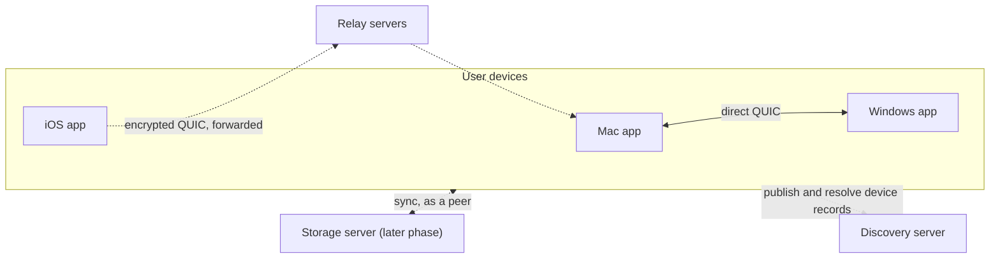

# Deployment

What infrastructure Osaurus Sync needs, how to run it, and how to point the apps at it. For what
each server can observe, see the client guide's
[disclosure table](client-guide.md#what-each-setting-discloses).

## What runs where

There is no central data server. Conversations live on the user's devices, which sync with each
other directly. The servers only help devices find and reach each other.



| Component | Runs | Stores | Needed for |
| --- | --- | --- | --- |
| The core | Inside each app | Everything: events, views, attachments, keys (in the OS key store) | Always |
| Relay servers (`iroh-relay`) | Osaurus, two or more regions | Nothing durable | Sync between devices on different networks |
| Discovery server (`iroh-dns-server`) | Osaurus, one deployment | A signed record per device: its device id and home relay URL | Finding a device by its id over the internet; agent host records |
| Storage server | Not built yet | Full event history for the scopes it syncs | Delivery while the user's other devices are offline, compaction |

## Tiers

### LAN only

`defaultNetworkConfig()` has mDNS on and no servers. Devices on the same network find each other
and sync directly. Devices on different networks don't sync at all. Nothing needs deploying.

### Development and beta: number0's public servers

`n0PublicNetworkConfig()` uses the public relays and discovery server run by
[number0](https://n0.computer), the makers of Iroh. They're free and need no setup, so they're
the right choice while building the apps and for internal beta builds.

Don't ship them in a public release:

- They're shared with every other Iroh developer, rate limited, and come with no uptime
  guarantee.
- They aren't run for Osaurus, so their operator sees Osaurus device ids, IP addresses and
  traffic timing (never content).
- Every device has to use the same discovery server to find the others, so moving off it later
  needs every installed build to switch. Reading the config from remote configuration from the
  start makes that a config change rather than an app update.

### Launch: Osaurus servers

Run relays in at least two regions and one discovery server, and ship their URLs to the apps
through remote configuration. The next sections cover each.

## Relay servers

A relay forwards encrypted QUIC traffic between devices that can't reach each other directly,
and helps them set up a direct path (NAT traversal). Once a direct path works, traffic stops
going through the relay. Each device keeps a connection to one **home relay**, the one with the
lowest latency, and publishes its URL in its discovery record so other devices know where to
reach it.

Use the `iroh-relay` binary from the [Iroh releases](https://github.com/n0-computer/iroh/releases)
or the `n0computer/iroh-relay` container image, at the same major version as the `iroh` crate
in `Cargo.lock` (currently 1.x). A minimal configuration, with automatic TLS:

```toml
# /etc/iroh-relay/config.toml; run with `iroh-relay -c /etc/iroh-relay/config.toml`
http_bind_addr = "[::]:80"
enable_quic_addr_discovery = true

[tls]
https_bind_addr = "[::]:443"
hostname = "relay-us.example.com"
cert_mode = "LetsEncrypt"
cert_dir = "/var/lib/iroh-relay/certs"
contact = "ops@example.com"
```

| Port | Protocol | Purpose |
| --- | --- | --- |
| 443 | TCP | Relaying (HTTPS, upgraded to the relay protocol) |
| 80 | TCP | The ACME challenge and the captive-portal check |
| 7842 | UDP | QUIC address discovery: tells a device its public address, for NAT traversal |
| 9090 | TCP | Prometheus metrics. Keep it private |

Operating notes:

- **Regions.** Put relays near the users: at least two regions so a single region going down
  doesn't stop sync, for example one in the US and one in Europe. Devices pick the closest one
  as their home relay, and fall back to the others.
- **Health.** `GET https://<host>/healthz` returns 200 when the relay is up. Point uptime
  monitoring at it, and alert on the metrics for connected clients and bytes relayed.
- **Capacity.** Relays are stateless, so scaling means adding instances. Relayed traffic is the
  sync traffic of devices that can't connect directly, which is mostly phones on cellular
  networks. It's small for messages and larger for attachments and first syncs.
- **Access.** `iroh-relay` relays for any client by default (`access = "everyone"`), so anyone
  could use an Osaurus relay for their own traffic. Configure rate limits (the `limits`
  section). The core doesn't send relay access tokens yet, so restricting access with
  `access.shared_token` or an `access.http` check needs a change to `NetworkConfig` first.
- **Changing relays.** Add a new relay to the config before removing an old one, and keep the old
  one running until the installed apps have picked up the new list. Devices whose home relay
  disappears move to another, and republish their discovery record.

## Discovery server

The discovery server lets a device find another by its device id when they aren't on the same
network. Each device signs a small record (a [pkarr](https://pkarr.org) packet) holding its home
relay URL, and publishes it over HTTPS. Other devices resolve it over HTTPS or DNS. The records
are signed by the device keys, so the server can't forge or alter them.

Run [`iroh-dns-server`](https://github.com/n0-computer/iroh/tree/main/iroh-dns-server). It
serves:

- `/pkarr` over HTTPS, where devices publish (`PUT`) and resolve (`GET`) records. This is the
  `discoveryServer` URL, for example `https://dns.example.com/pkarr`.
- Authoritative DNS (UDP and TCP port 53) for the **origin** domain, which is the
  `discoveryOrigin`, for example `dns.example.com`. A device's record is served as TXT records
  under `_iroh.<device id in z-base-32>.<origin>`.

A configuration based on the upstream `config.prod.toml`:

```toml
pkarr_put_rate_limit = "smart"

[https]
port = 443
domains = ["dns.example.com"]
cert_mode = "lets_encrypt"
letsencrypt_prod = true

[dns]
port = 53
default_soa = "ns1.dns.example.com hostmaster.example.com 0 10800 3600 604800 3600"
default_ttl = 30
origins = ["dns.example.com", "."]
rr_a = "203.0.113.10"                 # the server's public IP
rr_ns = "ns1.dns.example.com."

[mainline]
enabled = false
```

Operating notes:

- **DNS delegation.** For DNS resolution to work, delegate the origin to the server: in the
  parent zone, an `NS` record for `dns.example.com` pointing at `ns1.dns.example.com`, and an
  `A` record for `ns1.dns.example.com` with the server's IP. The core resolves over HTTPS and
  DNS at once, so lookups still work without the delegation, but DNS answers are cached by
  resolvers along the way.
- **Record lifetime.** Devices republish every 5 minutes and when their home relay changes. The
  records have a 30-second TTL, so a device that changes relay is reachable again quickly.
- **State.** The server keeps the latest record per device in a local database. Losing it isn't
  fatal, because devices republish within minutes, but back it up or run it on a persistent
  volume so a restart doesn't make devices briefly unreachable.
- **One deployment.** Devices find each other only if they publish to and resolve from the same
  server, so don't shard it by region. Put it behind a load balancer if it needs to scale.
- **Agent records.** `publishAgentRecord` and `resolveAgent` use the same records, so agents
  need a discovery server too.

## Client configuration

Ship the network configuration through the app's remote configuration, and build a
`NetworkConfig` from it at open:

```swift
var net = defaultNetworkConfig()
net.relays = remote.syncRelays                 // ["https://relay-us.example.com", "https://relay-eu.example.com"]
net.discoveryServer = remote.syncDiscovery     // "https://dns.example.com/pkarr"
net.discoveryOrigin = remote.syncOrigin        // "dns.example.com"
let core = try SyncCore.open(dataDirectory: dir, deviceName: name, network: net)
```

```csharp
var net = OsaurusSyncFfiMethods.DefaultNetworkConfig() with
{
    Relays = remote.SyncRelays,
    DiscoveryServer = remote.SyncDiscovery,
    DiscoveryOrigin = remote.SyncOrigin,
};
using var core = OsaurusSync.Open(dir, Environment.MachineName, network: net);
```

- **Set the discovery server and origin together.** They must belong to the same deployment.
- **Keep `publish` at `relayOnly`** for user devices, so a device's record doesn't reveal its IP
  addresses. Only a server with a public address should use `directAddresses`.
- **Every device must agree on the discovery server.** Devices on different discovery servers
  can't find each other over the internet (they still sync on the same LAN). Relay lists can
  differ between devices, as long as each device can reach the other's home relay.
- **Keep a bundled default** in the app for when remote configuration hasn't loaded yet, and
  apply a new configuration at the next open rather than restarting a running core.
- **Turn mDNS off** (`mdns = false`) if the user declined the iOS local network permission.

## The storage server (later phase)

A storage server is an Osaurus-run device that syncs like any other peer and has the storage
role. The core already supports the role; the server binary isn't built yet. It would add:

- **Delivery while devices are offline.** A change made on one device would reach the server
  right away, and the user's other devices would pick it up whenever they come online, instead
  of waiting until both are online at once.
- **Compaction.** Devices compact a scope only up to what every known storing peer holds, so
  compaction starts once a storage server exists.
- **Backup.** Full history in one place, so recovery from the recovery phrase works even when
  every device is gone.

The open decision is what the server can read. Holding the scope keys makes it a member that can
read content, which allows server-side features but means trusting it with content. Storing only
ciphertext keeps content end-to-end encrypted, with the server limited to holding and forwarding
events. Before it ships, the storage role should also be limited to certified servers (see the
[threat model](threat-model.md#known-limits)).

## Rollout order

1. **Beta:** the apps use `n0PublicNetworkConfig()`, delivered through remote configuration.
2. **Before public launch:** deploy two or more relays and a discovery server, test them with a
   beta build, then switch the remote configuration. Every device has to switch discovery
   servers together, so switch everyone at once rather than gradually.
3. **Later:** add the storage server. How devices learn about it and admit it is part of that
   work.
