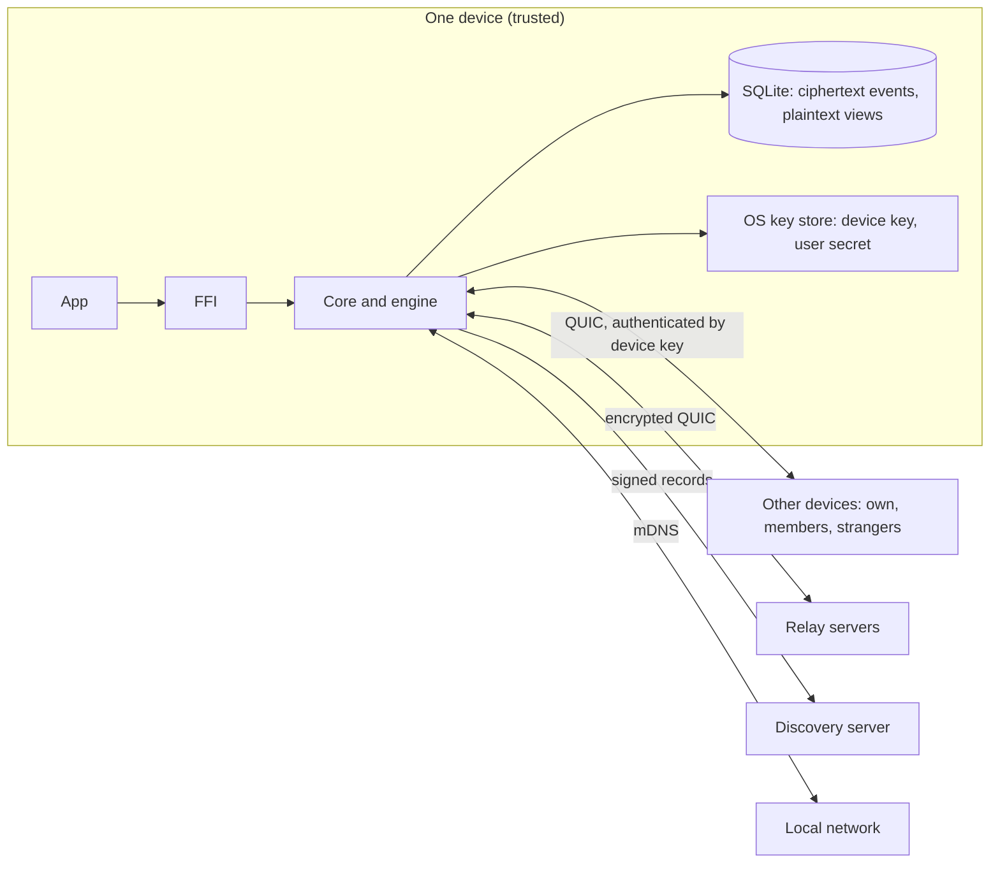

# Threat model

This document lists what Osaurus Sync protects, against whom, where the trust boundaries are,
and what it doesn't protect against. It reflects the code in this repository; the
[architecture](architecture.md) explains the mechanisms in more detail. Read it before changing
anything in `crypto.rs`, `identity.rs`, `auth.rs`, pairing, admission or rotation.

## What is protected

| Asset | Protection |
| --- | --- |
| Message text, edits, reactions, attachments, conversation titles (Loro) | End-to-end encrypted with per-scope epoch keys. Only devices of members hold the keys |
| Integrity and authorship of every event | Ed25519 signature by the authoring device, which a user certificate ties to its user |
| Membership and roles | Derived by every device from signed control events, deterministically and causally |
| The user secret (24-word phrase) | OS key store only; sealed to a new device's key during pairing and rotation |
| Device keys | OS key store only; never leave the device, never in SQLite |
| Availability of sync | Best effort: limits on what untrusted and trusted peers can make a device store or compute |

Not protected by the core: data on an unlocked device (see [local attacker](#local-attacker)),
traffic metadata (see the client guide's
[disclosure table](client-guide.md#what-each-setting-discloses)), and anything the app does with
plaintext it reads.

## Assumptions

- The operating system, the app process and the OS key store (Keychain, DPAPI) are not
  compromised. A device whose OS is compromised is equivalent to a stolen device.
- `getrandom` returns cryptographically secure randomness.
- The primitives hold: Ed25519 (`ed25519-dalek`), X25519 (`x25519-dalek`), XChaCha20-Poly1305,
  HKDF-SHA256, BLAKE3, and QUIC with TLS 1.3 as implemented by Iroh.
- The user keeps their phrase secret, and checks that a QR code or pairing code comes from their
  own device's screen.

## Trust boundaries

1. **The FFI boundary.** The app is trusted, but its inputs are validated: identifiers are
   parsed, paths for export are created by the core, attachment names are sanitized.
2. **The connection boundary.** A QUIC connection authenticates the remote endpoint id, which is
   the remote device key. Who the device is *for* comes from its certificate in `Hello`, checked
   by admission. Before admission, only `Hello`, pairing and invite redemption are processed,
   with at most 16 messages.
3. **The event boundary.** Every received event is decoded, size-checked, checked for a
   duplicate hash, signature-verified, and validated against the scope's control DAG before it
   is applied. Invalid events are stored as rejected, not applied.
4. **The scope key boundary.** A device can read a scope only if a `key_update` seals an epoch
   key to its device key or its user's recovery key.

## Attackers

### Network attacker

Someone on the path: a Wi-Fi operator, an ISP, a relay operator or the discovery server.

- **Can't** read or modify sync traffic: it's QUIC with TLS 1.3, authenticated by the device
  keys at both ends, and the content inside is end-to-end encrypted again with scope keys.
- **Can't** impersonate a device: the endpoint id is the device's public key. Discovery records
  are signed by the device key (pkarr), so a discovery server can serve stale records or none,
  but can't forge one.
- **Can't** replay usefully: events are content-addressed, so a replayed event is a duplicate.
- **Can** block, delay and drop traffic, and see metadata: device ids, IP addresses, who
  connects to whom, when and how much. The client guide lists exactly what each server learns.

### LAN attacker

Someone on the same network.

- Sees device ids and LAN addresses advertised by mDNS, and can advertise false addresses for a
  device id. Connecting to a false address fails authentication.
- **Pairing codes.** A code is 12 characters from a 32-character alphabet (60 bits), valid for
  the offer's lifetime (5 minutes by default), and the offer is cancelled after 5 wrong
  attempts, so online guessing succeeds with probability about 5 in 2^60.
- **Pairing with a spoofed device id.** A QR payload carries the host's device id, so the
  joiner dials the right device. A typed code doesn't: the app pairs the code with a device id
  it got some other way, possibly from an attacker. Pairing is therefore mutual. The joiner
  proves the code with a keyed BLAKE3 hash over both device keys, and the host's
  `PairingGrant` carries its own proof, under a separate key-derivation context. A device that
  doesn't know the code can't hand the joiner an identity
  (`a_device_that_does_not_know_the_code_cannot_grant_an_identity`).
- **Offline guessing.** An impostor that receives a joiner's proof could search the 60-bit code
  space offline, but it has to finish within the offer's lifetime and complete pairing with the
  real host before the user does, which is far out of reach. The proofs aren't a PAKE; see
  [known limits](#known-limits).

### Untrusted peer

Any device on the internet that knows a device id can connect.

- It's sent `Bye` unless admission trusts its certificate. The one exception is a device
  redeeming an open invite, which may send 16 messages.
- Frames are capped at 8 MiB and payloads at 4 MiB. Decoding happens before anything else, and
  every decoder (envelopes, protocol messages, stream frames, payloads, invites and pairing
  codes) and range reconciliation are fuzzed nightly (`fuzz/`).

### Revoked device

A device of this user that was revoked, such as a lost laptop.

- Other devices refuse its sessions and its events after the revocation's cutoffs, and every
  scope rotates to a new epoch key sealed only to the remaining devices.
- It keeps everything it already had, including old epochs.
- **If it still holds the user secret**, which every device of the user does, revocation alone
  isn't enough: it can derive the recovery key and read new epochs through recovery grants, and
  certify a fresh device key. A stolen device needs `revoke_and_rotate`, which replaces the user
  secret. A revoke is for devices that were wiped or are known to be gone.

### Malicious member

Another user in a shared scope, or a compromised device of one. Phase 1 has only the user's own
devices, but the permission engine is built for sharing.

- **Can't** forge other members' events, act above its role, or change history: authorization
  is evaluated from each event's own causal past, removals win over concurrent actions, and
  every device computes the same result.
- **Can** read everything in the scope while a member, and keep it after removal.
- **Can** write as much valid content as its role allows. Per-session budgets, held-event caps
  (10,000 events or 64 MiB per scope and per peer) and the cap of 1,000 invalid events per
  session bound what it can make a device buffer or reject, but not how much valid content it
  adds.
- **Can** send arbitrary Loro updates, which are imported into the scope's document. They're
  fuzzed (`loro_update`), and import failures are ignored, but a valid update can set any
  metadata a member may set.
- **Can** push its own clock up to an hour ahead (`MAX_FORWARD_DRIFT_MS`) to order its messages
  later. Clocks further ahead aren't adopted.
- **Can** claim the storage role. A storing peer's `Seen` watermark lets other devices compact
  history it claims to hold. A lying peer could get superseded edit payloads and folded Loro
  history dropped early; current messages and state aren't affected. See
  [known limits](#known-limits).

### Local attacker

Someone with access to the files of a device: another account on a shared machine, malware in
the user's account, or a copied disk.

- Event payloads are encrypted, but the view tables, including full-text search, hold
  plaintext. Phase 1 relies on full-disk encryption and the OS's per-user file permissions.
- Secrets are in the OS key store. The Keychain items are `AfterFirstUnlockThisDeviceOnly`, so
  a backup can't restore them onto another device. A DPAPI blob copied to another account
  doesn't decrypt.
- If the key store can't be read (before the first unlock, or a DPAPI blob from another user),
  open fails with `KeyStore` instead of creating a new identity over the old one.
- Malware running as the user can read the key store like the app can. That's outside this
  model.

## Cryptographic design

| Use | Construction |
| --- | --- |
| Event signatures | Ed25519 over the canonical signed bytes, which include the payload's BLAKE3 hash |
| Event hashes | BLAKE3 of the signed bytes |
| Payload encryption | XChaCha20-Poly1305 with the scope's epoch key; the event id is the associated data |
| Sealing to a device | Ephemeral X25519 with the recipient's Ed25519 key converted to Montgomery form; HKDF-SHA256 (salt: ephemeral and recipient keys) to an XChaCha20-Poly1305 key. Low-order keys are refused |
| User key, recovery key | HKDF from the 32-byte user secret, with separate labels |
| Pairing proofs | BLAKE3 keyed by `derive_key(context, code)` over both device keys; separate contexts for the joiner and the host |
| Attachments | A random key per blob, held only in the message's encrypted payload |

Device keys are used both to sign (Ed25519) and to receive sealed keys (X25519, after
conversion). That key reuse is deliberate and common, but it's one of the points for the
external review.

## Known limits

- **The identity-rotation race.** Holders of the same user secret can't be told apart. A thief
  with a stolen device who acts first, by revoking the user's other devices or rotating on their
  own, wins, and so does one who reaches a remaining device with an `IdentityHandoff` before the
  legitimate device does. Messages remaining devices send concurrently with a rotation can be
  rejected by its cutoffs. The stolen device keeps the epochs it already had.
- **No forward secrecy within an epoch, and no automatic healing.** A leaked epoch key exposes
  that epoch until the next rotation, which happens only on membership changes and revocations.
  MLS is deferred.
- **Pairing isn't a PAKE.** The 60-bit code, the short lifetime and the attempt limit make
  guessing impractical, but a shorter code or a long-lived offer would expose a captured proof
  to offline guessing. Moving to SPAKE2 or CPace would remove that.
- **Metadata.** Relays, discovery servers and the local network see device ids, addresses and
  traffic patterns. Control events (membership and roles) are plaintext to every device that
  syncs the scope's control layer.
- **Plaintext views at rest.** See [local attacker](#local-attacker).
- **Storing peers are trusted for compaction.** Any trusted peer can claim the storage role.
  Before a storage server ships, the role should be limited to the user's own devices or to
  certified servers.
- **Removed members keep what they had.** Removal stops future access only.
- **Edits, deletions and metadata changes count by their own causal past.** A removed member
  that hasn't yet seen its removal can still edit or delete its own messages, and change
  conversation metadata, until no connected member device accepts its sessions. Removal
  rejects its new messages. Purges can't be undone, so judging these by removals that arrive
  later would leave devices that compacted and devices that didn't with different views.
- **Denial of service** by trusted peers is bounded but not prevented.

## Verification

- Property tests and the simulation harness check convergence, causal authorization and that no
  event from a non-member or revoked device is applied (see the architecture's
  [testing section](architecture.md#testing-and-verification)).
- `fuzz/` has a cargo-fuzz target for each decoder and for reconciliation. The nightly workflow
  runs each for two minutes with a corpus carried over between nights; `scripts/fuzz.sh` runs
  them locally.
- `cargo deny` checks advisories on every push and nightly.

## External review

An external cryptography review is required before general availability. It hasn't been done
yet. The scope:

1. Ed25519 to X25519 conversion and the reuse of device keys for signing and sealing.
2. The sealing construction (`crypto.rs`: `seal_to_device`, `unseal`) and payload encryption,
   including nonce generation and associated data.
3. Pairing: both proofs, the grant, code generation and normalization, attempt limits.
4. Recovery grants: deriving the recovery key, sealing to it, and repairing missing grants.
5. Identity rotation and `IdentityHandoff`: who may hand over an identity, and the race above.
6. The envelope's canonical encoding and what the signature covers.
7. Epoch rotation on removal and revocation, and the cutoff rules in `auth.rs`.

To prepare: freeze the protocol version, tag the reviewed commit, and give the reviewers this
document, the architecture, `crypto.rs`, `identity.rs`, `keys.rs`, `auth.rs` and the engine's
pairing, admission and handoff code. Record findings and their fixes in the release notes of the
first GA release.
